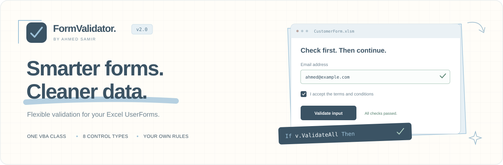

<p align="center">
  
</p>

<p align="center">
  <strong>One standalone VBA class for clear, reusable Excel UserForm validation.</strong><br>
  Required fields, custom regex patterns, numeric ranges, matching values, and your own business rules.
</p>

<p align="center">
  <a href="#quick-start">Quick start</a> &nbsp;·&nbsp;
  <a href="#validation-recipes">Examples</a> &nbsp;·&nbsp;
  <a href="#api-reference">API reference</a> &nbsp;·&nbsp;
  <a href="#upgrading-from-the-original-version">What changed?</a>
</p>

---

## Why FormValidator?

Give every field a clear set of rules before your save code runs. Register those rules once, validate a field or the entire form, and show helpful messages without repeating the same checks across your project.

- **One production file.** Import `FormValidator.cls` into your UserForm project.
- **Rules that compose.** Combine patterns, text length, numeric ranges, matching values, and custom rules.
- **Full-value matching by default.** A matching substring cannot silently stand in for a valid complete value.
- **Messages you control.** Set field-specific errors, a separate required message, and readable field labels.
- **Optional visual feedback.** Highlight invalid borders on supporting controls and restore their original appearance.
- **Eight supported control types.** Including multi-select ListBoxes and Boolean controls.
- **Separate error clearing and value resetting.** Keep the data when you only need to clear messages.
- **Custom business logic.** Handle the `CustomValidation` event for conditions specific to your form.

FormValidator returns validation results. Your code decides what to display, when to validate, and whether to save.

## Contents

- [Requirements](#requirements)
- [Installation](#installation)
- [Quick start](#quick-start)
- [Validation recipes](#validation-recipes)
- [Live validation](#live-validation)
- [Custom validation](#custom-validation)
- [Supported controls](#supported-controls)
- [API reference](#api-reference)
- [Errors, borders, and reset behavior](#errors-borders-and-reset-behavior)
- [Upgrading from the original version](#upgrading-from-the-original-version)
- [Regression tests](#regression-tests)
- [Frequently asked questions](#frequently-asked-questions)
- [Author](#author)

## Requirements

- Excel on Windows, with a VBA project containing a UserForm and Microsoft Forms (`MSForms`).
- Local availability of `Scripting.Dictionary`.
- A compatible regex engine when registering a pattern rule through `VBScript.RegExp`.

Dictionary and regex objects use **late binding**. You do not need to add separate checked references for those objects.

Required, length, numeric-range, matching, and custom rules do not need the regex engine. A regex object is created only when a pattern rule is registered. If it cannot be created, registration raises a descriptive error naming the control.

For regex compatibility, see [Microsoft's guidance on VBA and VBScript deprecation](https://devblogs.microsoft.com/microsoft365dev/how-to-prepare-vba-projects-for-vbscript-deprecation/). The current late-binding approach is supported in Microsoft 365 version 2508 or later; older Office versions depend on VBScript availability in Windows.

The library itself makes no network requests and uses no hosted service.

## Installation

1. Download [FormValidator.cls](FormValidator.cls), or get this repository's files.
2. Open your workbook and press **Alt+F11**.
3. Choose **File → Import File** and select `FormValidator.cls`.
4. Keep the class name `FormValidator` in the project.
5. Add your registration and validation code to the UserForm module.
6. Choose **Debug → Compile VBAProject**.
7. Save the workbook as a macro-enabled file, such as `.xlsm`.

If the original class is already in your project, export it for reference before replacing it. Only `FormValidator.cls` is required in production; the test modules are optional.

## Quick start

Create a UserForm with these controls:

| Control type | Name | Purpose |
| --- | --- | --- |
| TextBox | `txtEmail` | Email input |
| CheckBox | `chkAccept` | Agreement checkbox |
| CommandButton | `cmdSave` | Validate before saving |
| CommandButton | `cmdReset` | Reset registered values |

Paste this complete example into the **UserForm module**:

```vb
Option Explicit

Private v As FormValidator

Private Sub UserForm_Initialize()
    Set v = New FormValidator
    v.StrictRegistration = True
    v.ErrorBorderColor = RGB(211, 47, 47)

    ' A basic format check, not verification that the account exists.
    v.AddField Me.txtEmail, "[^\s@]+@[^\s@]+\.[^\s@]+", _
        "Enter a valid email address", _
        FieldLabel:="Email", _
        RequiredErrorMsg:="Email is required"

    v.AddField Me.chkAccept, "", "Please accept the terms", _
        MustBeTrue:=True, FieldLabel:="Terms"
End Sub

Private Sub cmdSave_Click()
    If v.ValidateAll Then
        ' Put your own save code here.
        MsgBox "All fields are valid.", vbInformation
    Else
        MsgBox v.ErrorSummary(IncludeFieldNames:=True), vbExclamation
        v.FocusFirstError
    End If
End Sub

Private Sub cmdReset_Click()
    v.ResetForm
End Sub

Private Sub UserForm_QueryClose(Cancel As Integer, CloseMode As Integer)
    If Not v Is Nothing Then v.ClearFields
    Set v = Nothing
End Sub
```

`ValidateAll` returns `True` only when every registered field passes. The success branch is where **your own save operation** belongs.

## Validation recipes

The following registration snippets belong in `UserForm_Initialize`, **after** `Set v = New FormValidator`. Add the named controls to your form before using a snippet.

### Require a value

An empty pattern disables regex checking and keeps the required-value check.

```vb
v.AddField Me.txtName, "", "Enter a name"
```

### Make a field optional

An empty optional field skips ordinary rules. A non-empty value must still pass its registered rules.

```vb
v.AddField Me.txtNickname, "[A-Za-z0-9_]+", _
    "Use letters, numbers or underscore", Required:=False
```

### Validate a complete pattern

```vb
v.AddField Me.txtCode, "[A-Z]{3}[0-9]{4}", _
    "Use 3 uppercase letters followed by 4 digits", IgnoreCase:=False
```

`ABC1234` passes. `prefixABC1234suffix` fails because `FullMatch=True` by default.

To intentionally search for a matching substring:

```vb
v.AddField Me.txtNotes, "[0-9]{3}", _
    "Include at least 3 consecutive digits", FullMatch:=False
```

### Stack multiple rules

```vb
v.AddField Me.txtUsername, "[A-Za-z0-9_]+", _
    "Use letters, numbers or underscore"

v.AddLengthRule Me.txtUsername, 3, 20, _
    "Use 3 to 20 characters"

v.AddPatternRule Me.txtUsername, ".*[A-Za-z].*", _
    "Include at least one letter"
```

Rules run in registration order. Only the **first failing rule per field** supplies the recorded message. `ErrorCount` counts failing fields, not failing rules.

### Set a numeric range

```vb
v.AddField Me.txtQuantity, "", "Enter a quantity"
v.AddNumberRangeRule Me.txtQuantity, 1, 100, _
    "Quantity must be from 1 to 100"
```

Both limits are inclusive. Parsing uses `IsNumeric` and `CDbl`, follows the Office/Windows locale, and compares `Double` values. This is not a text-format rule or an exact-decimal financial check. Use a pattern when the written format matters.

### Match another field

```vb
v.AddField Me.txtPassword, "", "Enter a password", TrimValue:=False
v.AddField Me.txtConfirm, "", "Confirm your password", TrimValue:=False

v.AddMatchRule Me.txtConfirm, Me.txtPassword, _
    "Passwords do not match"
```

Matching is case-sensitive by default. Set `IgnoreCase:=True` on `AddMatchRule` when appropriate. Both controls must have a single value; multi-select ListBoxes are not supported by this comparison rule. The peer control does not have to be registered.

Changing the original value does not automatically revalidate its dependent field. Call `ValidateField` on the confirmation field or use `ValidateAll`.

### Require a checked state

```vb
v.AddField Me.chkAccept, "", "Please accept the terms", _
    MustBeTrue:=True
```

`Required=True` alone permits an explicit Boolean `False` value. Use `MustBeTrue=True` when a CheckBox, OptionButton, or ToggleButton must be active.

### Customize required messages and labels

```vb
v.AddField Me.txtEmail, "[^\s@]+@[^\s@]+\.[^\s@]+", _
    "The email format is invalid", _
    FieldLabel:="Email", _
    RequiredErrorMsg:="Please enter your email"

' After validation:
MsgBox v.ErrorSummary(IncludeFieldNames:=True)
```

The label defaults to the control name. When `RequiredErrorMsg` is omitted or empty, the field uses `ErrorMsg` for the empty-value failure.

## Live validation

Wire a control event when you want immediate checking. The library does not automatically attach `Exit`, `Change`, or `KeyUp` handlers.

```vb
Private Sub txtEmail_Exit(ByVal Cancel As MSForms.ReturnBoolean)
    If v Is Nothing Then Exit Sub
    If v.IsBusy Then Exit Sub

    If Not v.ValidateField(Me.txtEmail) Then
        MsgBox v.GetErrorMessage(Me.txtEmail), vbExclamation
    End If
End Sub
```

Use the same guards in `Change` handlers. `ResetForm` can trigger native control events, and `IsBusy` lets your handler skip validation during that operation.

Keep the two guards separate: VBA does not short-circuit an `And` expression.

## Custom validation

For custom rules, declare the validator **WithEvents** at the top of the UserForm module. Replace the plain declaration from the quick-start example; do not declare `v` twice.

```vb
Private WithEvents v As FormValidator
```

Register your field and custom rule inside `UserForm_Initialize`, after creating `v`:

```vb
v.AddField Me.txtEndDate, "", "Enter an end date"
v.AddCustomRule Me.txtEndDate, "EndAfterStart", _
    "The end date must be after the start date"
```

Handle the event in the same UserForm module. This example assumes TextBoxes named `txtStartDate` and `txtEndDate` exist:

```vb
Private Sub v_CustomValidation(ByVal control As MSForms.Control, _
    ByVal Value As String, ByVal RuleName As String, _
    ByRef Handled As Boolean, ByRef IsValid As Boolean, _
    ByRef ErrorMessage As String)

    Select Case RuleName
        Case "EndAfterStart"
            Handled = True
            IsValid = False

            If Not IsDate(Value) Then
                ErrorMessage = "Enter a valid end date"
                Exit Sub
            End If

            If Not IsDate(Me.txtStartDate.Value) Then
                ErrorMessage = "Enter a valid start date first"
                Exit Sub
            End If

            IsValid = (CDate(Value) > CDate(Me.txtStartDate.Value))
    End Select
End Sub
```

- Set `Handled=True` for the rule you process. An unhandled custom rule raises a configuration error instead of accepting the value.
- Set `IsValid` explicitly. You can replace `ErrorMessage` with a more specific explanation.
- `Value` is the normalized text being checked. A multi-select ListBox can invoke the rule once per selected bound value.
- Date parsing in this example follows local settings. Parse explicitly when a fixed date format is required.
- For conditional requirements on an optional field, use `Required:=False` and `AddCustomRule(..., RunOnEmpty:=True)`.
- Avoid recursive validation or changing registrations from inside the callback. The busy guard rejects those operations.

## Supported controls

| MSForms control | Checked value | `ResetForm` behavior |
| --- | --- | --- |
| `TextBox` | Text checked against registered rules | Empty value |
| `ComboBox` | Selected or typed value, depending on the control | Clear selection and editable text |
| `ListBox` | One selected value, or every selected bound value | Clear selections |
| `CheckBox` | Boolean value; supports `MustBeTrue` | `False` |
| `OptionButton` | Boolean value; supports `MustBeTrue` | `False` |
| `ToggleButton` | Boolean value; supports `MustBeTrue` | `False` |
| `SpinButton` | Numeric value | Return to `Min` |
| `ScrollBar` | Numeric value | Return to `Min` |

For a multi-select ListBox, each selected value is read from `BoundColumn`. When `BoundColumn=0`, the row index is used. Every selected value must pass. No selections are treated as an empty value; an empty selected bound value also fails when the field is required.

Controls inside a `Frame` or `MultiPage` are supported when registered individually. Containers, Labels, Images, and CommandButtons are not registrable input fields.

Border coloring only applies to controls that expose the required border properties.

## API reference

### `AddField`

```vb
v.AddField control, Pattern, _
    ErrorMsg:="This field is invalid", _
    Required:=True, _
    TrimValue:=True, _
    ColorBorderOnError:=True, _
    FullMatch:=True, _
    IgnoreCase:=True, _
    MultiLine:=False, _
    MustBeTrue:=False, _
    FieldLabel:="", _
    RequiredErrorMsg:=""
```

`control` and `Pattern` are required arguments. Pass an empty pattern to skip regex checking.

| Argument | Default | Behavior |
| --- | --- | --- |
| `control` | Required argument | A supported `MSForms.Control` |
| `Pattern` | Required argument | A VBScript-compatible regex; `""` skips regex checking |
| `ErrorMsg` | `"This field is invalid"` | Base failure message; an empty message falls back to this default |
| `Required` | `True` | An empty normalized value fails |
| `TrimValue` | `True` | Ignore edge spaces, tabs, line breaks, and NBSP while checking |
| `ColorBorderOnError` | `True` | Enable optional border feedback for this field |
| `FullMatch` | `True` | Require the entire normalized value to match |
| `IgnoreCase` | `True` | Use case-insensitive regex matching |
| `MultiLine` | `False` | Allow line-based regex anchors when enabled |
| `MustBeTrue` | `False` | Require an active Boolean control |
| `FieldLabel` | Control name | Label used when error summaries include field names |
| `RequiredErrorMsg` | `ErrorMsg` | Separate message for an empty required value |

Registration is checked before the existing rule set is replaced. An invalid replacement pattern leaves the old registration, errors, and border state intact. A successful `AddField` call replaces **all** rules for that field and clears its old error.

### Additional rules

All target fields must already be registered through `AddField`.

| Method | Required arguments | Optional arguments and defaults |
| --- | --- | --- |
| `AddPatternRule` | `control`, `Pattern` | `ErrorMsg="This field is invalid"`, `FullMatch=True`, `IgnoreCase=True`, `MultiLine=False` |
| `AddLengthRule` | `control`, `MinLength` | `MaxLength=-1`, `ErrorMsg="The text length is invalid"` |
| `AddNumberRangeRule` | `control`, `Minimum`, `Maximum` | `ErrorMsg="Enter a number within the allowed range"` |
| `AddMatchRule` | `control`, `OtherControl` | `ErrorMsg="The values do not match"`, `IgnoreCase=False` |
| `AddCustomRule` | `control`, `RuleName` | `ErrorMsg="This field is invalid"`, `RunOnEmpty=False` |

`MaxLength=-1` means no upper limit. An additional pattern cannot be empty. Numeric minimum and maximum are inclusive. Appending a rule clears the target field's old error and highlighting; validate again to refresh its result.

### Validation and errors

| Member | Returns | Purpose |
| --- | --- | --- |
| `ValidateField(control)` | `Boolean` | Check one field and update its error state |
| `ValidateAll()` | `Boolean` | Check all registered fields |
| `HasError(control)` | `Boolean` | Check whether a field has a recorded error |
| `GetErrorMessage(control)` | `String` | Get its message, or `""` when none is recorded |
| `ErrorCount()` | `Long` | Count failing fields |
| `ErrorSummary(separator, IncludeFieldNames)` | `String` | Join errors in field registration order |
| `FirstInvalidControl` | `MSForms.Control` | Get the first recorded invalid control, or `Nothing` |
| `FocusFirstError()` | `Boolean` | Try to focus the first focusable invalid control |

`ErrorSummary` defaults to `separator=vbNewLine` and `IncludeFieldNames=False`.

`FocusFirstError` does not reveal hidden containers or switch MultiPage pages automatically. Call it when the form is shown.

### Registration and lifecycle

| Method | Returns | Purpose |
| --- | --- | --- |
| `HasField(control)` | `Boolean` | Check whether a control is registered |
| `FieldCount()` | `Long` | Count registered fields |
| `RemoveField(control)` | — | Unregister one field and restore its border |
| `ClearFields()` | — | Unregister all fields, clear errors, and restore borders |
| `ClearErrors()` | — | Clear messages and highlighting; keep values and rules |
| `ClearFieldError(control)` | — | Clear one field's error and highlighting |
| `ResetForm()` | — | Reset values by control type; clear errors and keep rules |

### Properties

| Property | Access | Default or meaning |
| --- | --- | --- |
| `ErrorBorderColor` | Read/write | `RGB(211, 47, 47)`; changing it updates currently invalid supporting controls |
| `StrictRegistration` | Read/write | `False`; enable to reject `ValidateField` on an unregistered control |
| `SkipDisabled` | Read/write | `False`; when enabled, skip controls whose own `Enabled` is `False` |
| `SkipHidden` | Read/write | `False`; when enabled, skip controls whose own `Visible` is `False` |
| `IsBusy` | Read-only | `True` while validation or reset is running |
| `FirstInvalidControl` | Read-only | First recorded invalid control, or `Nothing` |
| `Version` | Read-only | `"2.0.0"` |

The skip options inspect the control itself, not its ancestor containers or the active MultiPage page. Property changes do not automatically revalidate existing data.

### Event

```vb
Public Event CustomValidation(ByVal control As MSForms.Control, _
    ByVal Value As String, ByVal RuleName As String, _
    ByRef Handled As Boolean, ByRef IsValid As Boolean, _
    ByRef ErrorMessage As String)
```

Handle this event in your UserForm; do not paste the event declaration into it. See [Custom validation](#custom-validation) for the handler signature.

## Errors, borders, and reset behavior

### Error state is a snapshot

Messages describe the **last completed validation**. Editing a value does not automatically update that snapshot. Call `ValidateField` or `ValidateAll` to refresh it.

If a configuration error or custom callback exception interrupts `ValidateAll`, the previous library-managed error snapshot and borders remain intact. This does not roll back changes your callback makes to control values or other objects.

### Original appearance is retained

Where supported, the class retains the original `BorderStyle`, `BorderColor`, and `SpecialEffect` from the first registration. Passing validation, clearing the error, replacing the rule, or unregistering the field restores the original appearance.

Set `ColorBorderOnError:=False` to disable highlighting for a specific field. Validation still runs.

### Clearing is different from resetting

```vb
' Keep all values and rules, remove error messages and highlighting.
v.ClearErrors

' Clear one field's error only.
v.ClearFieldError Me.txtEmail

' Reset values according to control type; keep registration and rules.
v.ResetForm

' Remove registrations and errors, restoring original borders.
v.ClearFields
```

`ResetForm` attempts every registered control and reports any reset failures. It is **not transactional**: already reset values are not rolled back. Data-bound controls update their bound sources as usual.

Use one validator instance per form. A control name that belongs to another control is rejected explicitly. Do not rename a registered control; remove and re-register it instead.

## Upgrading from the original version

The first six `AddField` arguments are preserved. New options are appended, but two matching defaults intentionally change.

| Behavior | Original version | Version 2.0 |
| --- | --- | --- |
| Whole-value matching | A pattern could accept a matching substring | `FullMatch=True` by default |
| Multiline regex mode | Always enabled | `MultiLine=False` by default; configurable |
| Case-insensitive regex | Always enabled | `IgnoreCase=True` by default; configurable |
| Rules per field | One regex plus the required check | Multiple patterns, length, range, match, and custom rules |
| Invalid regex syntax | Discovered during validation | Checked during registration, with the control name |
| Re-registration | Could capture an error border as the original | Retains the original appearance and clears stale errors |
| Field removal | Could leave error highlighting behind | Restores the original border |
| Reset | Tried an empty string for every control | Uses type-specific reset behavior and reports failures |
| Error clearing | No separate public clear operation | `ClearErrors` and `ClearFieldError` |
| Multi-select ListBox | A single `.Value` read was insufficient | Checks selected bound values individually |

To intentionally preserve substring searching and multiline anchors for a field:

```vb
v.AddField Me.txtCode, "\d{3}", "Include 3 digits", _
    FullMatch:=False, MultiLine:=True
```

`TrimValue=True` now also handles edge tabs, line breaks, and NBSP. It does not rewrite the control's value. Use `TrimValue:=False` when every character should remain significant.

## Regression tests

The repository includes **85 assertions prepared for execution in Excel**. They cover matching behavior, regex syntax errors, border restoration, rule composition, reset behavior, multi-selection, callbacks, and reentrancy handling.

1. Import `FormValidator.cls`.
2. Import [tests/FormValidatorTestEvents.cls](tests/FormValidatorTestEvents.cls).
3. Import [tests/FormValidatorTests.bas](tests/FormValidatorTests.bas).
4. Create an empty UserForm named `UserForm1`, without custom events.
5. Open the Immediate Window with **Ctrl+G** and run:

```vb
RunFormValidatorTests UserForm1
```

The tests create temporary controls with the `FVTest` prefix and remove them when finished. A successful run reports the number of passed assertions.

**Verification status:** the source was reviewed and checked locally for consistency. The supplied VBA tests were **not executed inside Excel** in the preparation environment. Run them against your Office version and project.

## Frequently asked questions

<details>
<summary><strong>Does the library save records automatically?</strong></summary>

No. Call `ValidateAll` before your own save operation, and proceed only when it returns `True`.

</details>

<details>
<summary><strong>Does it automatically attach control events?</strong></summary>

No. Use your UserForm's `Exit`, `Change`, `KeyUp`, or button events to call validation when needed. Custom rules use the separate `CustomValidation` event.

</details>

<details>
<summary><strong>Why does an unchecked CheckBox pass Required?</strong></summary>

Because `False` is an explicit Boolean value, not an empty value. Use `MustBeTrue:=True` for a mandatory checked state.

</details>

<details>
<summary><strong>Can I use the class without regex rules?</strong></summary>

Yes. Pass an empty pattern to `AddField`. Required, length, numeric-range, matching, and custom rules do not create a regex object.

</details>

<details>
<summary><strong>Can I use the class on Mac?</strong></summary>

The current design targets Windows and uses Windows COM components. Mac compatibility is not provided by this version.

</details>

<details>
<summary><strong>Is this a complete email verification service?</strong></summary>

No. The email pattern in the examples is a basic format check. It does not verify account existence, ownership, or deliverability.

</details>

## Author

**Ahmed Samir** · Excel & VBA

[Find tutorials and contact links](https://linktr.ee/ahmedsamir00003)

If you report an issue, include your Office and Windows versions, a minimal registration example, the input value, and the behavior you expected.
